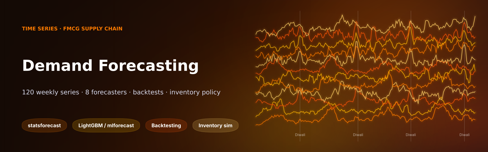
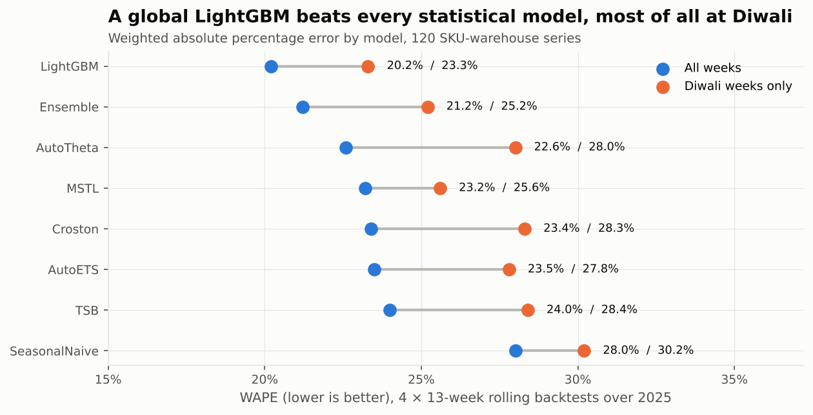
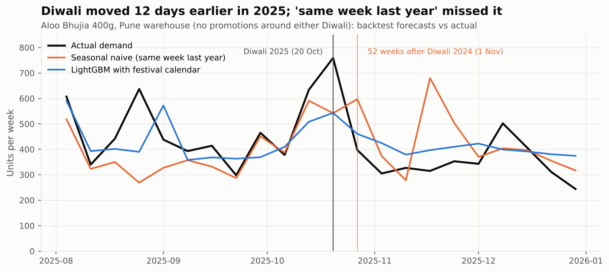
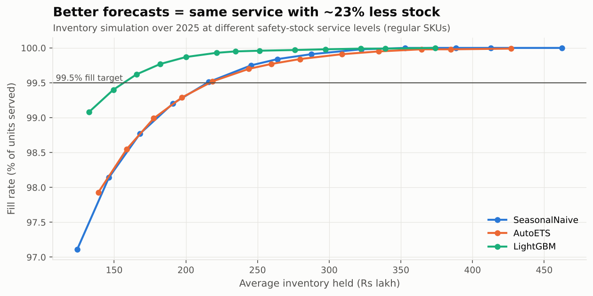
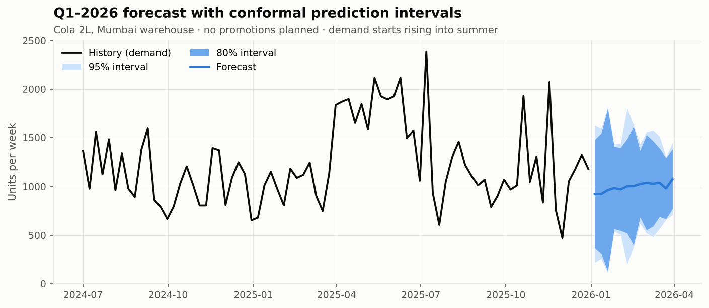

<p align="center"></p>

<p align="center">
  
  
  
  
  
</p>

# Weekly Demand Forecasting and Inventory Policy for an FMCG Distributor

**Business problem:** an FMCG distributor in Maharashtra (warehouses in Mumbai, Pune and Nagpur; 40 SKUs; 4 years of weekly sell-in)
plans replenishment with "same week last year". That rule breaks every year because Indian festivals move:
Diwali fell on 1 Nov 2024 and 20 Oct 2025. It also over-stocks, because a noisy forecast needs a large safety buffer.

**What this project does:**

1. **Cleans the target.** It recovers demand hidden by stock-outs, so models learn demand rather than supply failures.
2. **Segments 120 series** with ABC-XYZ to decide where forecasting effort pays.
3. **Benchmarks 8 forecasters in rolling-origin backtests:** seasonal naive, AutoETS, AutoTheta, MSTL, Croston, TSB, a **global LightGBM** with festival and promotion features, and an ensemble.
4. **Turns forecasts into money.** It sets a safety-stock policy and simulates inventory to measure how much working capital a better forecast releases at the same service level.
5. **Forecasts Q1-2026** with conformal prediction intervals.

Everything runs in one executed notebook: [`notebooks/demand_forecasting.ipynb`](notebooks/demand_forecasting.ipynb)

> **Data note:** synthetic data generated by [`src/generate_data.py`](src/generate_data.py) (seed 31).
> Built in: category seasonality (summer beverages, monsoon tea and noodles, winter ghee), moving festivals (Diwali, Holi, Ganesh Chaturthi, Eid),
> promotions with post-promo dips, stock-outs, intermittent festive SKUs, an April-2024 price rise and a competitor launch.

---

## Results

| | Result |
|---|---|
| 🎯 | **The global LightGBM cuts forecast error by 28%** versus "same week last year" (WAPE **20.2% vs 28.0%**) and beats every statistical model. AutoTheta is the best statistical model at 22.6%. |
| 🪔 | **In Diwali weeks**, LightGBM with festival-calendar features scores 23.3% WAPE against 30.2% for seasonal naive. Seasonal naive puts the spike where Diwali fell *last* year. |
| 💰 | **Working capital:** to hit the same **99.5% fill rate**, LightGBM forecasts need **₹165 lakh** of average stock versus **₹216 lakh** with seasonal naive. That is **₹50 lakh (23%) less inventory** for the same service. |
| 🧹 | **644 stock-out weeks** were corrected, recovering **1.34 lakh units of hidden demand** (1.5% of sales) that raw sales would have taught the models to under-forecast. |
| 🧩 | **ABC-XYZ model selection:** LightGBM wins 5 of 7 classes. The 19 erratic CZ series drop from 63% to 43% WAPE. |
| 🎁 | **Festive gift SKUs** (diyas, gift boxes) defeat every time-series model (WAPE above 70%). The recommendation is to plan them as **events** with pre-booked quantities, not weekly replenishment. Knowing when *not* to use a model is part of the job. |

<p align="center">
  
  
</p>
<p align="center">
  
  
</p>

---

## Approach

| Step | Detail |
|---|---|
| **Censored demand** | In stock-out weeks, demand is re-estimated as the median of the surrounding ±3 in-stock, non-promo weeks. It is never lowered. |
| **ABC-XYZ** | ABC on the last 52 weeks of inventory value (80 / 15 / 5%). XYZ on the weekly coefficient of variation (≤0.25 / ≤0.5 / >0.5). |
| **Statistical models** | [`statsforecast`](https://github.com/Nixtla/statsforecast): SeasonalNaive(52), AutoETS, AutoTheta, MSTL (ETS trend), CrostonOptimized and TSB for intermittent demand. *AutoARIMA with a 52-week season was benchmarked and dropped: about 75 s per series in backtesting.* |
| **ML model** | One **global LightGBM** across all 120 series via [`mlforecast`](https://github.com/Nixtla/mlforecast). Features: lags 1–4/13/52, rolling mean/std, week-of-year, month, promotion flag and festival-calendar weights (known in advance). Log1p target transform. |
| **Backtesting** | Rolling origin: 4 cut-offs × 13-week horizon covering all of 2025. Metrics are WAPE and bias, overall, per ABC-XYZ class and in Diwali weeks only. |
| **Inventory policy** | Safety stock = z × σ(forecast error) × √lead time. A weekly order-up-to simulation per series, run across a grid of service levels. Models are compared on **inventory needed at a matched fill rate**, the comparison that matters to finance. |
| **Final forecast** | Refit on all history. 13-week forecast with 80/95% **conformal prediction intervals** in [`reports/forecast_q1_2026.csv`](reports/forecast_q1_2026.csv), plus a safety-stock table in [`reports/safety_stock_policy.csv`](reports/safety_stock_policy.csv). |

## Run it

```bash
pip install -r requirements.txt
python src/generate_data.py
cd notebooks && jupyter nbconvert --to notebook --execute --inplace demand_forecasting.ipynb   # ~1 min
pytest -q
```

Tests cover the festival calendar (Diwali week alignment), the censored-demand correction (never lowers demand), ABC shares,
metric maths, a mini backtest (all models, no negative forecasts, horizon length), **no look-ahead** (every forecast date is after its cut-off),
and safety stock rising with the service level.

## Structure

```
├── notebooks/demand_forecasting.ipynb   executed analysis
├── src/
│   ├── generate_data.py                 synthetic weekly sell-in + festival calendar
│   ├── forecasting.py                   cleaning, ABC-XYZ, models, backtest, metrics, inventory simulation
│   └── charts.py
├── reports/                             Q1-2026 forecast with intervals, safety-stock policy
├── images/ · assets/
└── tests/
```

---

**Author:** Husein Ghadiali · Data Analyst · supply-chain and wholesale-distribution analytics · [LinkedIn](https://linkedin.com/in/husein-ghadiali)
